<p align="center">
  
</p>

<h1 align="center">Event Music Player</h1>

<p align="center">
  <b>Музыкальный пульт для мероприятий: фон, отбивки, пэды, микшер и пульт на телефоне.</b><br>
  Для турниров, праздников и любых ивентов, где музыкой рулит один человек с ноутбуком.
</p>

<p align="center">
  
  
  
  
  
</p>

<p align="center">
  <a href="#start">Быстрый старт</a> ·
  <a href="#storage">Где что хранится</a> ·
  <a href="#share">Как поделиться</a> ·
  <a href="#tour">Тур по программе</a> ·
  <a href="#keys">Клавиши</a> ·
  <a href="#faq">Проблемы</a>
</p>

<p align="center">
  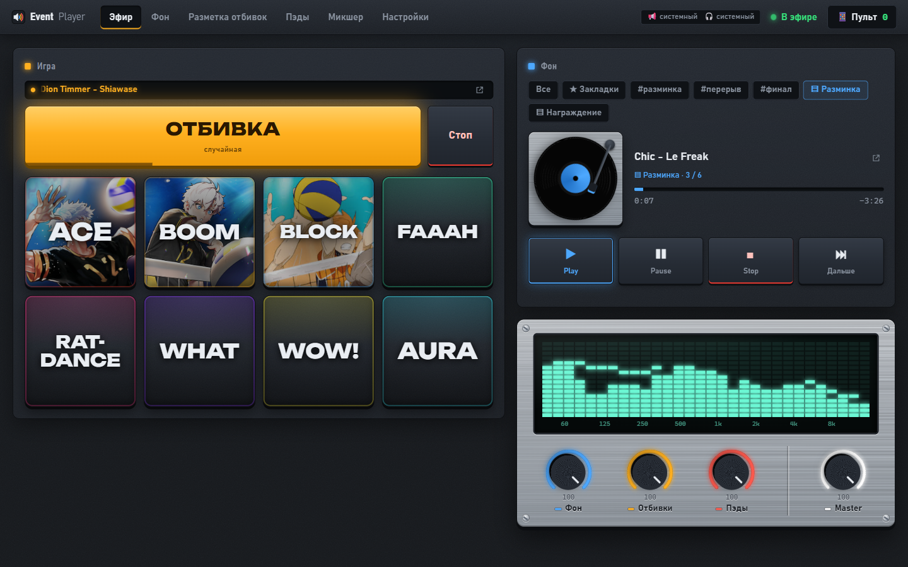
</p>

---

## ✨ Что умеет

| | |
|---|---|
| 🎵 **Фон** | Музыка весь день без повторов. Теги, закладки и плейлисты, которые продолжают с того места, где остановились |
| 📣 **Отбивки** | Одна большая кнопка — и звучит дроп из случайного трека. Точки, длины и фейды размечаются на волне |
| 🥁 **Пэды** | 8 пэдов в банке, банков сколько угодно. Обрезка, фейды, громкость, картинка, режимы «один раз / по кругу / пока держишь» |
| 🎚 **Микшер** | 4 канала с эквалайзером, компрессором и лимитером — каждый открывается окном «как настоящий прибор» |
| 📱 **Пульт на телефоне** | QR-код — и любой телефон в той же сети управляет эфиром. Без приложений |
| 🎹 **MIDI** | AKAI MPK Mini, контроллеры в MIDI-режиме: любые кнопки, пэды и крутилки назначаются за пару кликов |
| 🎧 **Два звуковых выхода** | Эфир в колонки, прослушка в наушники: готовишь треки, пока зал слушает музыку |
| 🧳 **Переносится одной папкой** | Вся музыка, разметка и настройки — в `music/`. Скопировал папку — у другого человека всё то же самое |
| 🔌 **Без интернета** | Всё работает локально. Интернет нужен только один раз, при первом запуске |

---

<a id="start"></a>

## 🚀 Быстрый старт

1. Скачай программу: на странице репозитория **Code → Download ZIP** и распакуй.
2. Положи музыку в папки (они создадутся сами при первом запуске):
   - `music/background/` — фоновая музыка;
   - `music/jingles/` — треки для отбивок.
3. Дважды кликни **`start.bat`**. Откроется браузер на `http://localhost:8080`.
4. Нажми **«▶ Начать эфир»**.

> [!TIP]
> Первый запуск делай дома с интернетом. Если на компьютере нет Node.js, `start.bat` сам скачает
> переносную версию с официального nodejs.org в папку `runtime/` — в систему ничего не устанавливается.
> Дальше интернет не нужен.

> [!IMPORTANT]
> Окно с сервером (чёрная консоль) не закрывай, пока идёт мероприятие. Браузер — **Chrome или Edge**:
> на них рассчитаны MIDI, выбор звуковых устройств и точные фейды.

Форматы звука: mp3, wav, ogg, m4a, aac, flac. Картинки для пэдов: png, jpg, webp, gif.

---

<a id="storage"></a>

## 🗂 Где что хранится

Программа состоит из двух независимых частей:

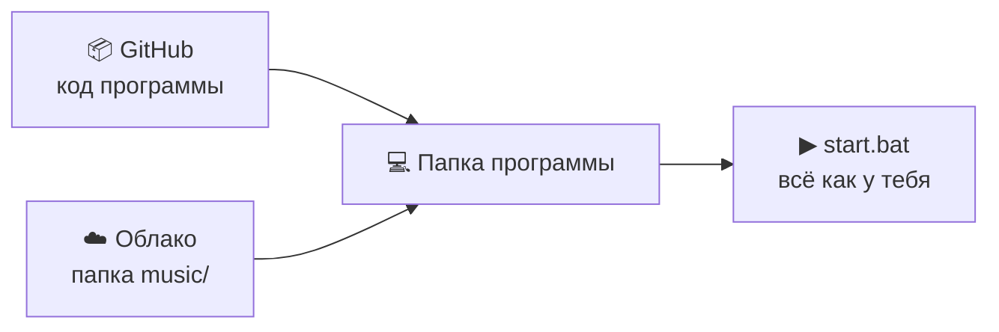

**Код** лежит на GitHub и одинаков у всех. **Данные** — одна папка `music/` на твоём компьютере.
В git она не попадает никогда: так прописано в `.gitignore`.

| Что | Где |
|---|---|
| фоновая музыка | `music/background/` |
| треки отбивок | `music/jingles/трек.mp3` |
| разметка отбивки (точки, длины, фейды, разделы) | `music/jingles/трек.json` — рядом с треком |
| звуки пэдов | `music/samples/` (копируются туда сами, когда бросаешь файл на пэд) |
| картинки пэдов | `music/images/` (тоже сами) |
| пэды и банки, плейлисты / теги / закладки фона, микшер, MIDI, общие настройки | `music/settings.json` |

Внутри все ссылки идут только по **именам файлов**, без путей к диску, поэтому папка работает на любом
компьютере и в любом месте.

<details>
<summary><b>Что хранится в браузере и не переезжает</b></summary>

<br>

Несколько вещей привязаны к конкретному компьютеру или к конкретному дню, поэтому живут в браузере, а не в `music/`:

- выбор звуковых устройств («Куда идёт звук») — на другом ноутбуке другие звуковые карты;
- «MIDI включён» — зависит от того, подключён ли контроллер;
- счётчики ротации отбивок и фона («что уже играло сегодня») — на новом мероприятии им правильно начинаться с нуля.

Ещё не переносятся папки `node_modules/` и `runtime/` — они скачиваются сами.
</details>

---

<a id="share"></a>

## 📦 Как поделиться программой

Например, ты отдаёшь турнир другу, и у него должно быть всё то же самое, что у тебя.

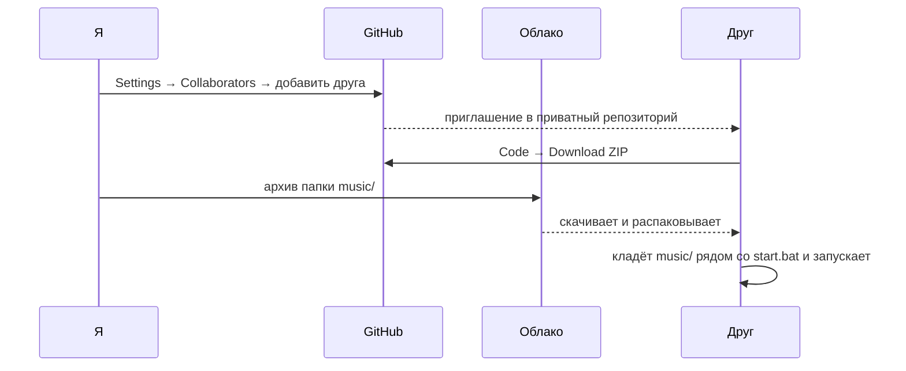

1. **Код.** Репозиторий приватный, поэтому сначала добавь человека: *Settings → Collaborators → Add people*.
   Он принимает приглашение и скачивает *Code → Download ZIP*.
2. **Данные.** Заархивируй свою папку `music/` целиком и отправь через облако.
3. **У друга.** Распаковать программу, положить `music/` внутрь, рядом со `start.bat`, и запустить:

   ```text
   event-music-player/
   ├─ start.bat
   ├─ server.js
   ├─ public/
   └─ music/            ← из облака
      ├─ settings.json
      ├─ background/
      ├─ jingles/
      ├─ samples/
      └─ images/
   ```

После этого у друга те же пэды с картинками и обрезкой, те же плейлисты, та же разметка отбивок и тот же микшер.

> [!TIP]
> Совсем без GitHub: положи в облако всю папку программы целиком вместе с `music/` (без `.git/` и `node_modules/`).
> Человек скачивает одну папку и запускает `start.bat`.

> [!NOTE]
> Синхронизации нет. Если ты потом поменял пэды или плейлист, отправь заново только `settings.json` —
> он целиком заменит настройки у друга. Новая версия кода с GitHub папку `music/` не трогает.

---

<a id="tour"></a>

## 🧭 Тур по программе

### 🔴 Эфир

Главный экран на мероприятии. Слева **игра**, справа **фон** и **уровни**.

<p align="center"></p>

- **Табло над отбивкой** показывает, что играет сейчас или что играло последним. Значок ↗ справа открывает этот трек
  в «Разметке отбивок» — если отбивка вдруг оказалась неудачной, её сразу можно поправить.
- **Большая янтарная клавиша «Отбивка»** запускает случайную отбивку по честной ротации. Повторное нажатие — другая отбивка,
  **«Стоп»** — плавное затухание. Под ней — разделы (`#рок`, `#house`…), если их включили.
- **Пэды** — крупные, с названием капсом и картинкой. Над ними переключатель банков. Значок ⟳ — пэд играет по кругу,
  ✋ — звучит, пока держишь.
- **Фон** — пластинка крутится, пока играет музыка. Кнопки над ней выбирают источник: все треки, закладки,
  тег или плейлист. Под названием трека видно, откуда он играет («▤ Разминка · 1 / 6»), а значок ↗ открывает трек во вкладке «Фон».
- **Уровни** — алюминиевая площадка с крутилками **Фон, Отбивки, Пэды** и **Master** (это те же фейдеры, что в микшере)
  и экран спектра того, что уходит в колонки.
- В шапке: лампа **«В эфире»**, плашка **📢 / 🎧** (куда идёт звук), индикатор **MIDI** и кнопка **📱 Пульт** с числом подключённых телефонов.

> [!NOTE]
> Браузер разрешает звук только после клика, поэтому эфир включается кнопкой «Начать эфир».
> Если открыть вторую вкладку с плеером и нажать там «Начать эфир», она заберёт эфир себе, а первая отключится.

---

### 🎵 Фон

Библиотека фоновой музыки из `music/background`. Разметки у фона нет: трек играет целиком.

<p align="center">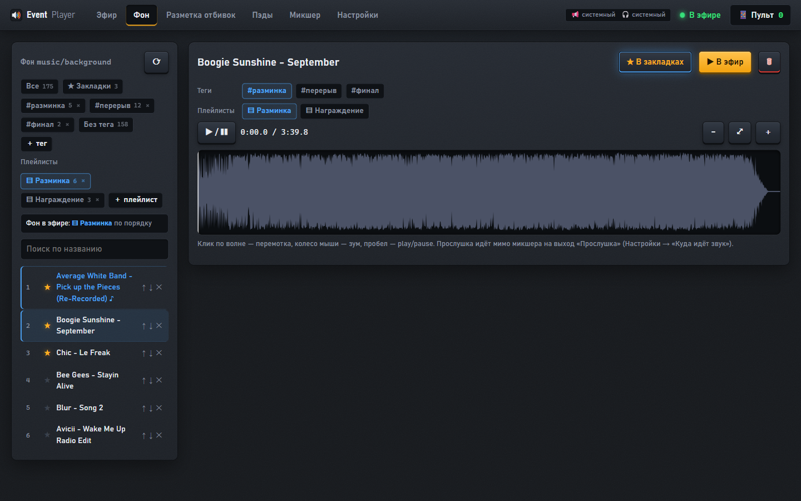</p>

**Слева — группы и список:**

- **Все / ★ Закладки / #теги / Без тега** — фильтры списка. Цифра рядом — сколько в группе треков.
- **＋ тег** — свои теги: «разминка», «перерыв», «финал»… Трек перетаскивается на тег мышкой.
- **Плейлисты** (**＋ плейлист**) — треки идут **по порядку**. В открытом плейлисте ↑ ↓ меняют порядок, ✕ убирает трек.
- **Поиск по названию** — регистр не важен, `_` и `-` считаются пробелами.
- **«▶ Играть …»** делает открытую группу источником фона в эфире. Сейчас играющий трек отмечен ♪.

**Справа — открытый трек:**

- волна: клик — перемотка, колесо мыши — зум, **пробел** — play/pause;
- **★ В закладки**, теги и плейлисты трека включаются кликом;
- **▶ В эфир** — поставить этот трек фоном прямо сейчас (переходом, если фон уже играет);
- **🗑** — удалить трек из папки (в Корзину Windows) и из всех тегов, закладок и плейлистов.

**Как играет фон:**

| Источник | Порядок | Pause → Play | Stop → Play | «Дальше» |
|---|---|---|---|---|
| Все / тег / закладки | вперемешку, без повторов | с того же места | новый трек по ротации | новый трек по ротации |
| Плейлист | по порядку, по кругу | с того же места | **следующий** трек плейлиста | следующий трек плейлиста |

Место в плейлисте запоминается в `settings.json` и переживает даже перезапуск программы. Смена источника не обрывает музыку:
текущий трек доигрывает, следующий берётся уже из нового источника.

> [!TIP]
> Прослушка во вкладке идёт мимо микшера на выход **«Прослушка»**. Если развести звук на два устройства
> (см. [Куда идёт звук](#outputs)), можно готовить плейлист в наушниках прямо во время эфира.

---

### 📣 Разметка отбивок

Здесь решается, **какой кусок** трека прозвучит по кнопке «Отбивка».

<p align="center">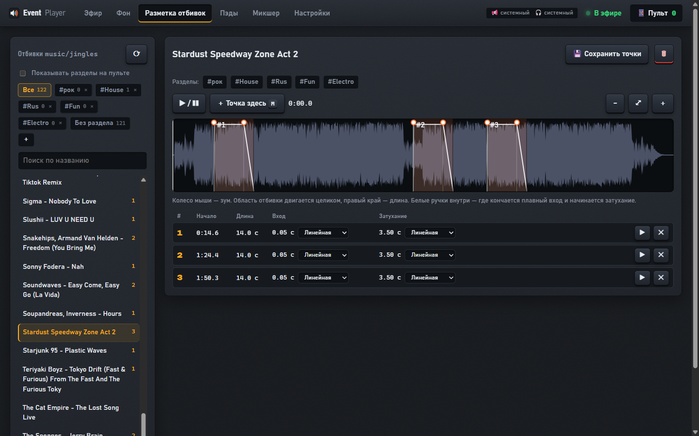</p>

1. Выбери трек слева (есть **поиск по названию**; цифра справа — сколько у трека точек).
2. Найди дроп: клик по волне перематывает, **колесо мыши** приближает вокруг курсора, **пробел** — play/pause.
3. Нажми **M** (или «＋ Точка здесь»). Появится оранжевая **область отбивки**:
   - область двигается целиком, а **правый край** задаёт длину именно этой отбивки;
   - белые **ручки** внутри — где кончается плавный вход и начинается затухание. Белая дуга показывает, как меняется громкость.
4. В таблице точек выбирается **форма** входа и затухания: Линейная, Ease-in, Ease-out, S-кривая, Equal power.
   ▶ проигрывает точку ровно так, как она прозвучит в эфире.
5. **💾 Сохранить точки** (кнопка загорается, когда есть что сохранять).

- Точка, у которой поменяли длину или фейды, отмечается янтарной полосой. Кнопка **↺ свои** возвращает общие значения из «Настроек».
- **Разделы** (`＋` над списком): «рок», «house», «смешное»… Трек перетаскивается на раздел или отмечается в редакторе.
  Галочка «Показывать разделы на пульте» добавляет под кнопкой «Отбивка» переключатель `#случайные / #рок / …`.
- **🗑** удаляет трек вместе с разметкой (в Корзину Windows).
- В эфир попадают **только треки, у которых есть точки**.

---

### 🥁 Пэды

<p align="center">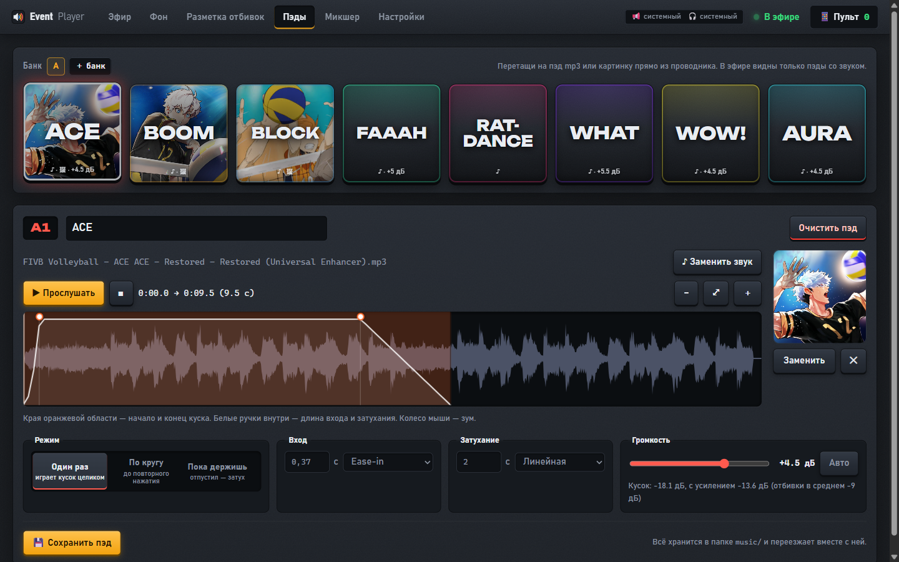</p>

- **Банк** — 8 пэдов в ряд сверху. **＋ банк** добавляет новый, двойной клик по банку переименовывает, × удаляет.
- **Перетащи mp3 или картинку прямо из Проводника на пэд** — файл скопируется в `music/samples` или `music/images` сам.
  Под пэдом видно: ♪ звук, 🖼 картинка, усиление, режим. Красная рамка и «⚠ нет файла» — звук не перенесли вместе с папкой.

**Редактор пэда:**

| Блок | Что делает |
|---|---|
| **Название** | крупно и капсом на пэде в эфире; шрифт сам подстраивается под ширину |
| **Звук** | «Заменить звук», «▶ Прослушать» (с обрезкой, фейдами и громкостью — как в эфире), волна с зумом |
| **Обрезка** | края оранжевой области — начало и конец куска. Сам файл не меняется |
| **Картинка** | справа: перетащи файл или нажми «Заменить», ✕ убирает |
| **Режим** | *Один раз* — играет кусок целиком · *По кругу* — до повторного нажатия · *Пока держишь* — отпустил, и затих |
| **Вход / Затухание** | секунды и форма кривой; то же самое — белыми ручками на волне |
| **Громкость** | от −12 до +12 дБ. **«Авто»** измеряет кусок и подгоняет его к средней громкости отбивок (≈ −9 дБ) |

> [!TIP]
> Повторное нажатие на играющий пэд плавно его гасит, а быстрый двойной тап — обрывает сразу.

---

### 🎚 Микшер

Четыре канала, как в студийной программе: **Фон, Отбивки, Пэды, Master**.

<p align="center">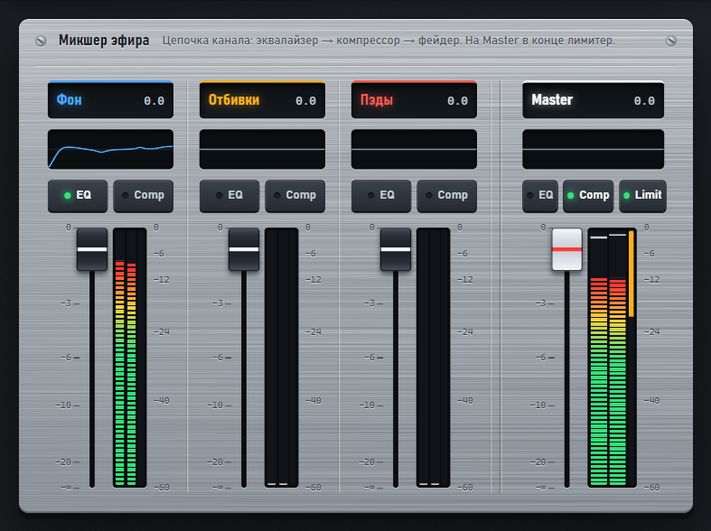</p>

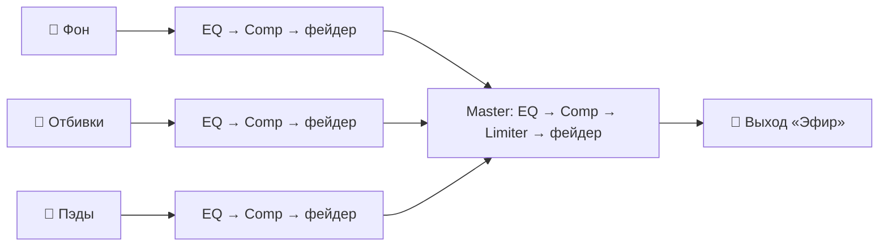

- На каждом канале: подпись с уровнем в дБ, мини-график эквалайзера, кнопки **EQ / Comp** (на Master ещё **Limit**)
  с зелёной лампой «включено», фейдер и стерео-индикатор с удержанием пика и полосой подавления компрессора.
- Двойной клик по фейдеру — 0 дБ. Фейдеры — это те же крутилки, что в «Уровнях» и на пульте.
- Лимитер на Master **включён по умолчанию** (потолок −1 дБ): колонки не хрипят, даже если пэдам добавили громкости.
- Звук меняется сразу. Без эфира настройки просто сохраняются. На телефоне микшера нет — только на ноутбуке.

#### Эквалайзер

<p align="center">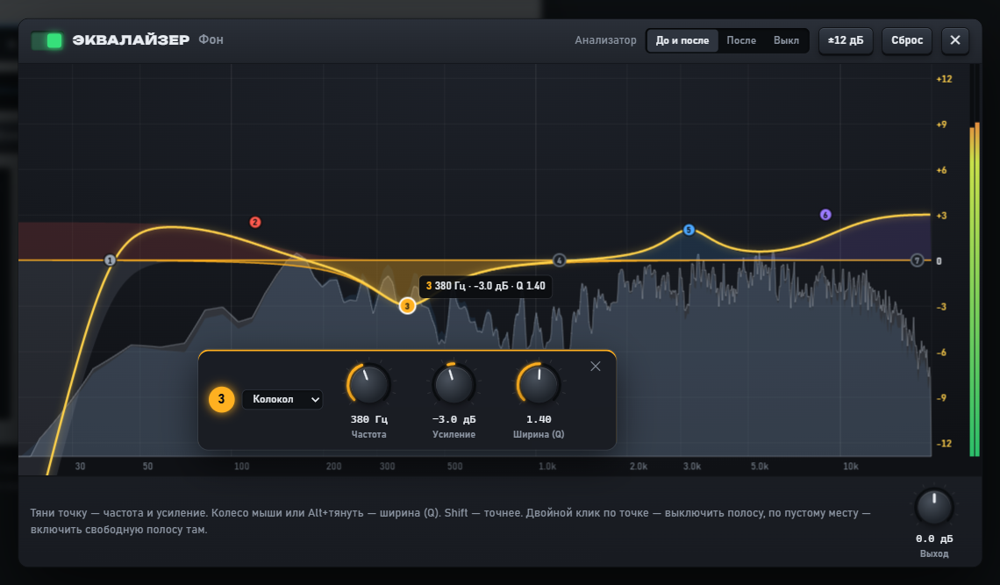</p>

- 7 полос: срезы НЧ/ВЧ, полки, колокола, режекция. У каждой полосы **своя цветная форма**, общая кривая — жёлтая.
- **Тяни точку** — частота и усиление. **Колесо мыши** или **Alt + тянуть** — ширина (Q). **Shift** — точнее.
- **Клик по точке** открывает панель полосы: тип, крутизна среза **12 / 24 / 36 / 48 дБ/окт**,
  крутилки «Частота», «Усиление», «Ширина (Q)».
- **Двойной клик** по точке выключает полосу, по пустому месту — включает свободную полосу в этой точке.
- **Анализатор** «до и после» эквалайзера (в эфире), справа индикатор выхода, внизу общий **«Выход»**.
- **±12 дБ** — масштаб шкалы (6 / 12 / 24), **Сброс** — все усиления в 0.

#### Компрессор и лимитер

| Компрессор | Лимитер (только Master) |
|---|---|
| 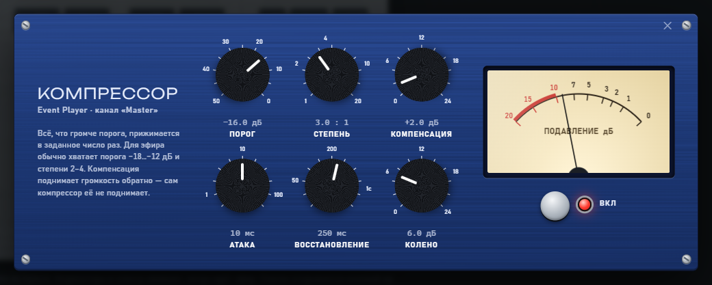 | 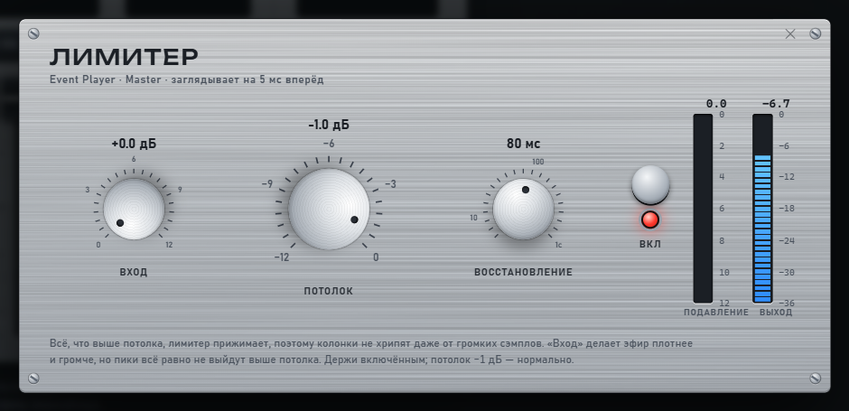 |
| Порог, степень, компенсация, атака, восстановление, колено. Стрелочный индикатор показывает, на сколько дБ прижат звук | **Вход** — громче и плотнее, **Потолок** — выше него не выйдет ни один отсчёт, **Восстановление**. Индикаторы подавления и выхода |

> [!TIP]
> Для эфира обычно хватает компрессора с порогом −18…−12 дБ и степенью 2–4. Компенсацию добавляй руками:
> сам компрессор громкость не поднимает. Потолок лимитера −1 дБ — нормально.

У всех крутилок плагинов: тянуть вверх-вниз, **Shift** — точнее, колесо мыши, **двойной клик** — значение по умолчанию.

---

### ⚙️ Настройки

<p align="center">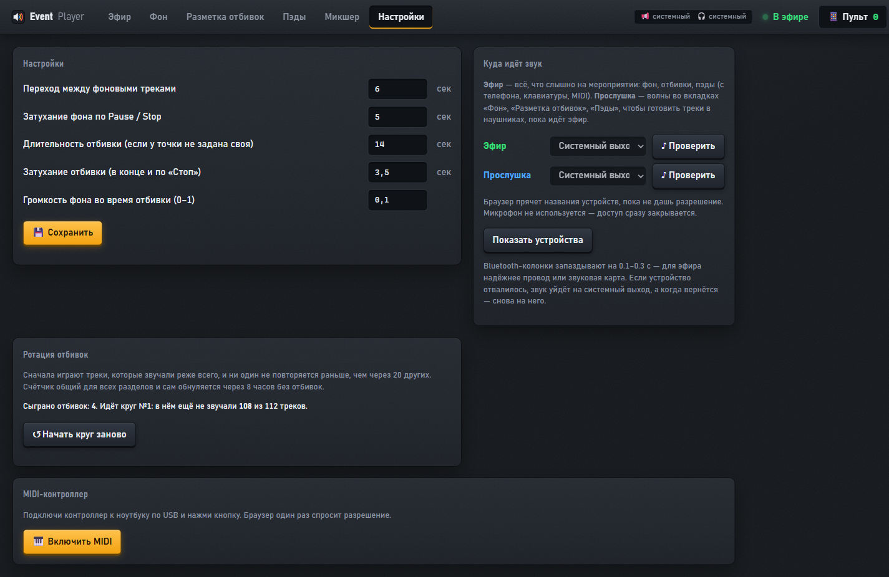</p>

**Общие:** переход между фоновыми треками, затухание фона по Pause/Stop, длина отбивки и её затухание
(если у точки не задано своё), громкость фона во время отбивки.

<a id="outputs"></a>

#### 🔈 Куда идёт звук

Звук разводится на **два устройства**:

| Линия | Что в неё идёт | Обычно |
|---|---|---|
| 📢 **Эфир** | всё, что слышит зал: фон, отбивки, пэды — с ноутбука, телефона или MIDI | внешняя звуковая карта → колонки |
| 🎧 **Прослушка** | волны во вкладках «Фон», «Разметка отбивок», «Пэды» | встроенная карта ноутбука → наушники |

- **«Показать устройства»** — браузер показывает названия звуковых устройств только после разрешения «микрофона».
  Сам микрофон не используется: доступ сразу закрывается.
- **«♪ Проверить»** пищит в выбранное устройство (эфир — выше, прослушка — ниже).
- Устройство отвалилось — звук уходит на системный выход, плашка в шапке краснеет. Вернулось — звук сам возвращается на него.

> [!WARNING]
> Bluetooth запаздывает на 0.1–0.3 с: отбивка по свистку прозвучит позже. Для эфира надёжнее провод или звуковая карта.

#### 🎲 Ротация отбивок

Статистика: сколько отбивок сыграно и сколько треков в этом круге ещё не звучало. **«↺ Начать круг заново»** сбрасывает счётчик.

#### 🎹 MIDI-контроллер

1. Подключи контроллер к ноутбуку по USB и нажми **«Включить MIDI»** (браузер один раз спросит разрешение).
2. Напротив действия нажми **«Назначить»**, затем пэд, кнопку или крутилку на контроллере. **Esc** отменяет.
3. Справа вверху видно последнее сообщение от контроллера — удобно понять, что вообще шлёт устройство.

Назначить можно: отбивку и её стоп, пэды 1–8 текущего банка, банк вперёд/назад и банки 1–4, фон play/pause, stop
и «дальше», громкость Master / Фон / Отбивки / Пэды на крутилки.

- **AKAI MPK Mini mk3** работает сразу: пэды шлют ноты, крутилки — CC. Bank A/B дают ещё 8 нот.
- **Native Instruments (Traktor)** многие модели по умолчанию работают по HID и браузеру не видны.
  Переведи контроллер в **MIDI-режим** (NI Controller Editor или комбинация кнопок — см. инструкцию к модели).

---

### 📱 Пульт на телефоне

Нажми **📱 Пульт** в шапке и отсканируй QR телефоном. Никаких приложений: пульт открывается в браузере телефона.

<p align="center">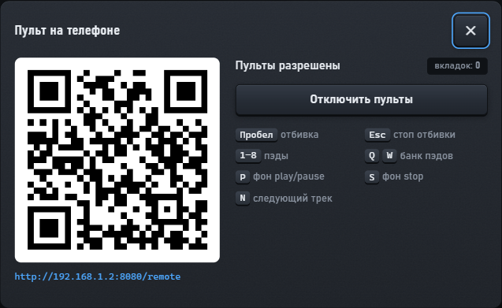</p>

<table>
  <tr><th>Игра</th><th>Фон</th><th>Уровни</th></tr>
  <tr valign="top">
    <td>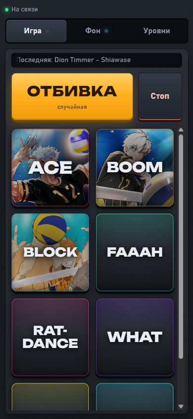</td>
    <td>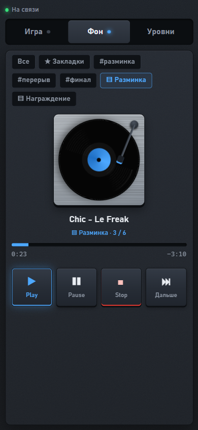</td>
    <td>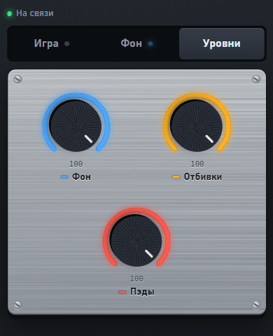</td>
  </tr>
  <tr valign="top">
    <td>отбивка, разделы, банки и пэды</td>
    <td>пластинка, источник фона, транспорт</td>
    <td>крутилки громкости каналов</td>
  </tr>
</table>

- Телефонов может быть несколько. Одна вкладка на телефон: новая вытесняет прежнюю.
- **«Отключить пульты»** разрывает связь со всеми телефонами и не пускает новые, пока не нажмёшь «Разрешить пульты».
- **Весь звук играет на ноутбуке**, телефон только шлёт команды. Если связь пропала, пульт сам переподключится.

---

<a id="keys"></a>

## ⌨️ Горячие клавиши

**Во вкладке «Эфир»:**

| Клавиша | Действие |
|---|---|
| <kbd>Пробел</kbd> | отбивка |
| <kbd>Esc</kbd> | стоп отбивки |
| <kbd>1</kbd> … <kbd>8</kbd> | пэды текущего банка по порядку (у «пока держишь» — пока клавиша нажата) |
| <kbd>Q</kbd> / <kbd>W</kbd> | банк назад / вперёд |
| <kbd>P</kbd> | фон play / pause |
| <kbd>S</kbd> | фон stop |
| <kbd>N</kbd> | следующий фоновый трек |

**В редакторах:** <kbd>Пробел</kbd> — play/pause волны, <kbd>M</kbd> — точка отбивки здесь.
Клавиши работают и в русской раскладке.

---

## 🔊 Как ведёт себя звук

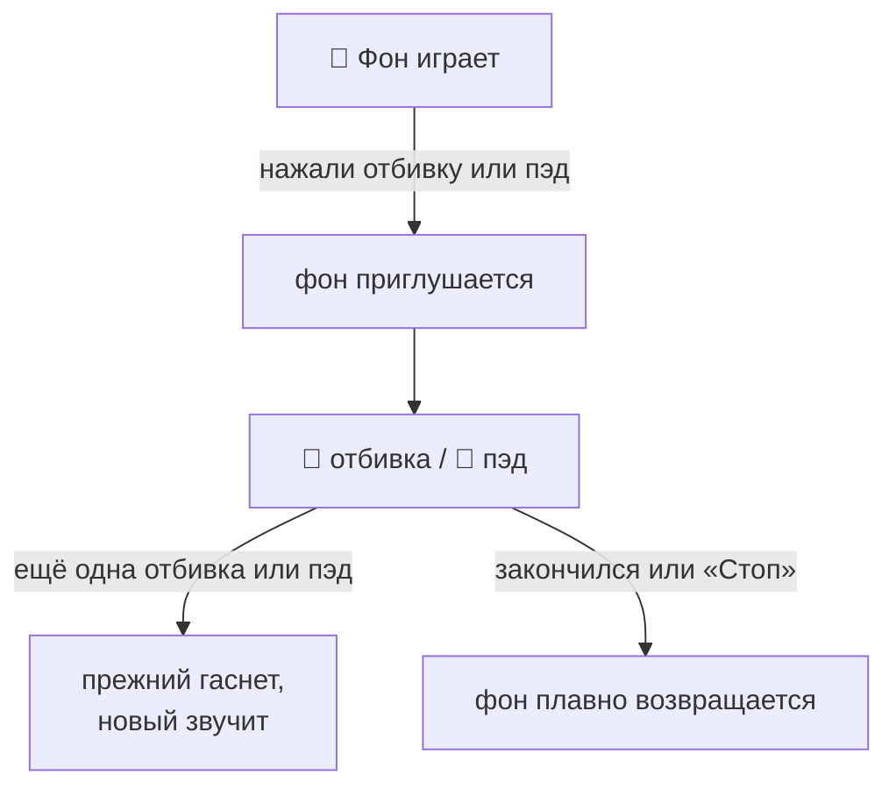

- **Фон** переходит между треками плавным перекрытием. *Pause* и *Stop* гасят плавно.
- **Отбивка** — трек и точка по ротации, длина и фейды точки (или общие из «Настроек»).
- **Пэд** — свой кусок, свои фейды, громкость и режим.
- Отбивка и пэд **вытесняют друг друга**. Пока любой из них звучит, фон приглушён.

### 🎲 Честная ротация

Чтобы на турнире не звучало одно и то же:

- сначала играют треки, которые звучали **реже всего**;
- ни один трек не повторяется раньше, чем через **20 других** (или пока не прозвучат все, если треков меньше);
- внутри трека **точки тоже чередуются**;
- счётчик **общий для всех разделов**: трек, сыгранный в `#рок`, уходит в конец очереди и в «случайных»;
- счётчик переживает перезагрузку вкладки и сам обнуляется через **8 часов** без музыки.

Фон выбирается так же (кроме плейлистов — они играют по порядку).

---

## ✅ Чек-лист перед турниром

**Дома:**

- [ ] Первый запуск `start.bat` с интернетом, проверить звук
- [ ] Разметить отбивки и пэды, собрать плейлисты фона
- [ ] Положить свежую папку `music/` в облако — это и бэкап, и комплект для другого человека

**На месте:**

- [ ] Отключить сон и гибернацию ноутбука при работе от сети
- [ ] Громкость Windows — **100%**, дальше регулировать в программе
- [ ] Включить на телефоне **точку доступа** (мобильный интернет не нужен) и подключить к ней ноутбук
- [ ] `start.bat` → **«Начать эфир»**
- [ ] «Настройки» → «Куда идёт звук»: эфир → колонки, прослушка → наушники, нажать «♪ Проверить»
- [ ] **📱 Пульт** → отсканировать QR телефоном
- [ ] На телефоне увеличить время до блокировки экрана, иначе пульт «уснёт»

---

<a id="faq"></a>

## 🩺 Решение проблем

<details>
<summary><b>Телефон не подключается к пульту</b></summary>

<br>

- Телефон и ноутбук должны быть в **одной сети** (удобнее всего — точка доступа с телефона).
- Если Windows спросила про брандмауэр — **разрешить** доступ для частных сетей.
- Сеть в Windows должна быть помечена как **«Частная»**, а не «Общедоступная».
- В окне «Пульт» проверь, что пульты **разрешены**.
</details>

<details>
<summary><b>Нет звука</b></summary>

<br>

- Нажата ли **«Начать эфир»**? Без клика браузер звук не разрешает.
- Посмотри плашку 📢 в шапке: куда сейчас идёт эфир. Нажми «♪ Проверить» в настройках.
- Громкость Windows и фейдеры в «Уровнях» / «Микшере» не на нуле?
- Отбивки играют только из треков, у которых есть **точки**.
</details>

<details>
<summary><b>Пэд с красной рамкой «⚠ нет файла»</b></summary>

<br>

Настройки пэда есть, а звука в `music/samples/` нет — скорее всего, папку перенесли не целиком.
Положи файл с тем же именем в `music/samples/` или брось звук на пэд заново.
</details>

<details>
<summary><b>Не видно названий звуковых устройств</b></summary>

<br>

Нажми «Показать устройства» и разреши доступ к «микрофону» — без этого браузер прячет названия.
Работает только в Chrome и Edge.
</details>

<details>
<summary><b>MIDI-контроллер не виден</b></summary>

<br>

- Нажата ли «Включить MIDI» и разрешён ли доступ?
- Контроллер подключается к **ноутбуку**, а не к телефону.
- Контроллеры Native Instruments переведи в **MIDI-режим** (по умолчанию многие работают по HID).
</details>

<details>
<summary><b>Случайно удалил трек</b></summary>

<br>

Удалённые из программы треки лежат в **Корзине Windows**: открой её и нажми «Восстановить» — файл вернётся на место.
У отбивки рядом лежит и её разметка (`трек.json`) — восстанови оба файла. Из тегов и плейлистов фоновый трек
при удалении убирается — его нужно будет добавить туда заново.
</details>

<details>
<summary><b>Эфир внезапно отключился</b></summary>

<br>

Скорее всего, плеер открыли во второй вкладке и нажали там «Начать эфир» — эфир может быть только в одной вкладке.
На экране будет «Эфир перехвачен другой вкладкой». Закрой лишнюю вкладку и нажми «↻ Забрать эфир сюда».
</details>

---

## 🛠 Для разработчиков

Сервер на **Node.js** (Express + WebSocket) раздаёт интерфейс и файлы и хранит настройки.
**Весь звук играет в браузере ноутбука** через Web Audio API. Телефон только шлёт команды.
Без сборки и фреймворков: обычные ES-модули, браузер открывает их как есть.

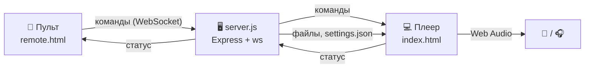

| Файл | Что делает |
|---|---|
| `server.js` | API, `music/settings.json` и разметка, удаление в Корзину, WebSocket-мост пульт ↔ плеер, QR |
| `public/engine.js` | аудио-движок: фон (источники, плейлисты), отбивки, пэды, ротация, банки |
| `public/mixer.js` | канальная линейка: EQ (биквады, срезы до 48 дБ/окт) → компрессор → фейдер, лимитер на Master |
| `public/dynamics-worklet.js` | компрессор и лимитер на AudioWorklet |
| `public/mixer-ui.js` | вкладка «Микшер» и окна плагинов, крутилки плагинов |
| `public/outputs.js` | выбор устройств для эфира и прослушки (`setSinkId`) |
| `public/envelope.js` | формы фейдов, расписание громкости, измерение громкости куска |
| `public/wave-envelope.js` | дуга и ручки фейдов поверх волны, прослушка в редакторах |
| `public/app.js` | интерфейс ноутбука: эфир, фон, разметка, пэды, настройки, MIDI |
| `public/pad.js` | панель эфира, общая для ноутбука и телефона, экран спектра |
| `public/midi.js` | Web MIDI: разбор сообщений, «Назначить» |
| `start.bat` | запуск; при необходимости скачивает переносной Node.js и зависимости |

<details>
<summary><b>Почему так, а не иначе</b></summary>

<br>

- **Свой компрессор и лимитер.** Встроенный `DynamicsCompressorNode` по спецификации незаметно добавляет компенсацию
  громкости, а как лимитер не гарантирует потолок. Наш лимитер заглядывает на 5 мс вперёд — выше потолка не выходит
  ни один отсчёт, даже когда крутят «Вход».
- **Без щелчков.** Схема канала собирается один раз и не пересоединяется: выключенный блок становится прозрачным,
  включение и выключение — плавный переход за 10–15 мс.
- **Q у срезов.** Для фильтров `highpass`/`lowpass` Web Audio принимает Q в децибелах — программа пересчитывает его,
  поэтому срезы ровные (Баттерворт: −3 дБ на частоте среза).
- **Удаление в Корзину.** Через `Microsoft.VisualBasic.FileIO.FileSystem` в PowerShell; пути передаются
  через переменную окружения, а не текстом команды.
- **Музыка не в git.** Это гигабайты, у треков свои правообладатели, а переносится папка через облако.
</details>

<details>
<summary><b>Текстуры оформления (необязательно)</b></summary>

<br>

Без картинок металл и резина нарисованы CSS и SVG-шумом. Если положить файлы в `public/textures/`, они подхватятся сами:

| Файл | Где | Что нужно |
|---|---|---|
| `aluminum.jpg` | микшер, «Уровни», площадка пластинки | шлифованный алюминий, **горизонтальная** шлифовка, светло-серый, без бликов, 1024×1024 |
| `panel.jpg` | фон приложения | тёмный анодированный металл, почти чёрный графит (≈ `#14171b`), мелкое зерно, 512×512 |
| `rubber.jpg` | пэды без картинки | матовая тёмная резина, как на пэдах MPC, 512×512 |

Все тайлы — **бесшовные** и спокойные, чтобы не спорить с текстом поверх.
</details>

---

## 📜 Лицензии и благодарности

| Компонент | Лицензия |
|---|---|
| [wavesurfer.js](https://wavesurfer.xyz) — волны и регионы | BSD-3-Clause |
| [Express](https://expressjs.com) — сервер | MIT |
| [ws](https://github.com/websockets/ws) — WebSocket | MIT |
| [node-qrcode](https://github.com/soldair/node-qrcode) — QR-код пульта | MIT |
| [Unbounded](https://github.com/googlefonts/unbounded) — шрифт названий пэдов (`public/fonts`) | SIL OFL 1.1 |

Музыка, сэмплы и картинки в папке `music/` принадлежат их правообладателям и в репозиторий не входят.

<p align="center"><sub>Сделано для мероприятий, где музыка должна просто работать. 🔊</sub></p>
